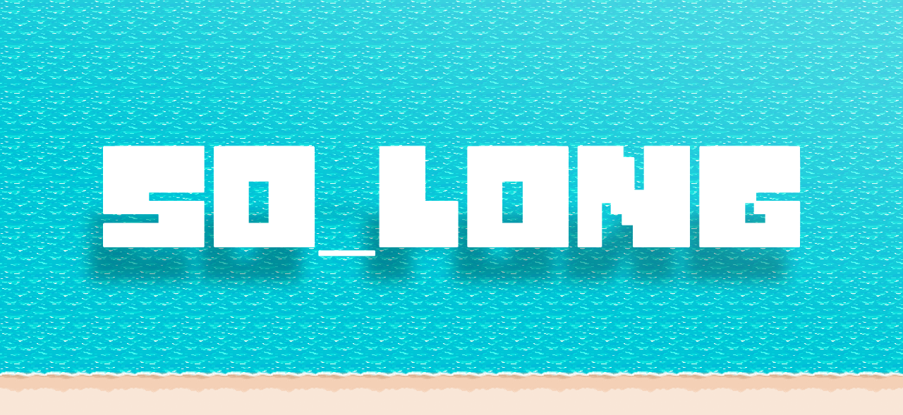

# so_long

### Pig's Bay 🌊

Welcome to **Pig's Bay**, a setting inspired by my hometown's most popular beach — Baía dos Porcos in Espinho.

### The Mission 🛥️

You play as a **trash-boat** on a noble mission to turn this aquatic dump into a less filthy one. Your objective is to navigate the ocean and collect every single pile of **garbage** floating around. The **lighthouse** will light up the moment you grab the last piece of trash, signaling you to follow the beacon.
When you reach the lighthouse, congratulations! The beach is officially cleaner now!

*Granted, the water is realistically still a complete biohazard and definitely unsafe for human recreation (seriously, why do people insist on swimming here???) but hey, at least you did your part...!*
